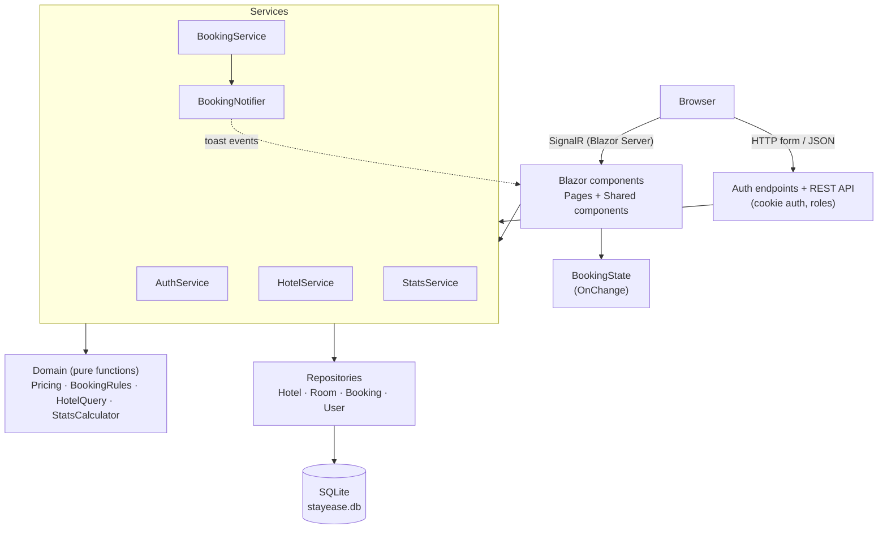
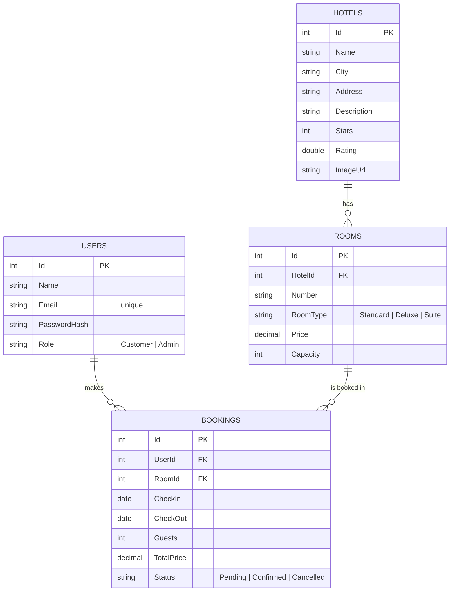

# StayEase — Hotel Booking System

StayEase is a hotel booking web application built with **C# / .NET 8**, **Blazor** (interactive server components), **Entity Framework Core + SQLite** and **cookie authentication with Customer / Admin roles**.

It was created for the *Introduction to Functional Programming* course, so the business rules (pricing, booking validation, search/filtering, statistics) are written as **pure functions over immutable data**, while the infrastructure (database, UI, HTTP) sits around them.

## Table of Contents

1. [Project Overview](#project-overview)
2. [Technologies Used](#technologies-used)
3. [Architecture](#architecture)
4. [Database ER Diagram](#database-er-diagram)
5. [Installation Guide](#installation-guide)
6. [User Guide](#user-guide)
7. [API Documentation](#api-documentation)
8. [Testing](#testing)
9. [Screenshots](#screenshots)
10. [Functional Programming Concepts](#functional-programming-concepts)

## Project Overview

| Area | What is implemented |
| --- | --- |
| **Hotels** | Search by name/city, filter by price, stars and rating, hotel details page with rooms |
| **Booking** | Booking form, live price summary, 10% discount from 7 nights, validation (past dates, capacity, overlapping dates), confirmation |
| **Availability Calendar** | Month calendar per room: free / booked / your selected dates |
| **Accounts** | Registration, login, logout; roles **Customer** and **Admin** |
| **Customer** | Browse hotels, create bookings, see own bookings, cancel a booking |
| **Admin** | Add / edit / delete hotels, add / delete rooms, see all bookings, change booking status |
| **Statistics dashboard** | Revenue, bookings, popular hotels, occupancy for the next 30 days, bookings by status |
| **Notifications** | Live toast notifications when a booking is created, confirmed or cancelled |
| **Persistence** | SQLite database — data stays after the application restarts |

Seeded accounts (created on first start):

| Role | Email | Password |
| --- | --- | --- |
| Admin | `admin@stayease.com` | `Admin123!` |
| Customer | `demo@stayease.com` | `Demo123!` |

## Technologies Used

| Layer | Technology |
| --- | --- |
| UI | Blazor Web App (interactive server rendering), Razor components, plain CSS |
| State management | `BookingState` service with an `OnChange` event |
| Back end | ASP.NET Core 8, Minimal API |
| Database | SQLite + Entity Framework Core 8 (`IDbContextFactory`, repository pattern) |
| Authentication | Cookie authentication, PBKDF2 password hashing, role-based authorization |
| Real-time | Blazor Server circuits (SignalR) + in-process `BookingNotifier` |
| Tests | xUnit, `WebApplicationFactory` for integration tests |

## Architecture



### Project structure

```
.
├── StayEase/
│   ├── Domain/                 # Entities, pure functions (Pricing, BookingRules, HotelQuery, StatsCalculator)
│   ├── Infrastructure/
│   │   ├── Data/               # StayEaseDbContext, DbInitializer (seed data)
│   │   └── Repositories/       # Hotel / Room / Booking / User repositories
│   ├── Services/               # Auth, Booking, Hotel, Stats, BookingState, ToastService, BookingNotifier
│   ├── Auth/                   # Login / register / logout endpoints
│   ├── Api/                    # REST API endpoints and DTOs
│   ├── Components/
│   │   ├── Layout/             # MainLayout
│   │   ├── Shared/             # HotelCard, HotelSearch, HotelFilter, BookingForm, BookingSummary,
│   │   │                       # AvailabilityCalendar, BarChart, Navbar, Toast, ConfirmDialog
│   │   └── Pages/              # Home, HotelDetails, MyBookings, AdminDashboard, Login, Register
│   ├── wwwroot/                # CSS and images
│   └── Program.cs
├── StayEase.Tests/             # Unit and integration tests
└── StayEase.sln
```

## Database ER Diagram



## Installation Guide

**Prerequisites:** [.NET 8 SDK](https://dotnet.microsoft.com/download) and internet access for the first `restore` (NuGet packages).

```bash
(https://github.com/abukaiumovaaruzhan-ctrl/final_project_Aruzhan_Ayauly.git)
cd <https://github.com/abukaiumovaaruzhan-ctrl/final_project_Aruzhan_Ayauly.git>
dotnet restore
dotnet run --project StayEase
```

Open **http://localhost:5080**. The SQLite file `StayEase/stayease.db` is created and filled with demo data on the first start. To reset all data, stop the app and delete that file.

Run the tests:

```bash
dotnet test
```

## User Guide

**As a visitor:** open the home page, search by name or city and use the filter (price, stars, rating). Open *View details* to see rooms and the availability calendar.

**As a customer:** register or log in, open a hotel, choose a room, pick check-in/check-out dates and the number of guests. The *Booking Summary* shows nights, subtotal, the 10% discount (7+ nights) and the total. Press *Confirm booking*. Under **My bookings** you can see and cancel your bookings (a confirmation dialog is shown).

**As an admin:** log in with the admin account and open **Admin**. There you can see statistics and charts, add/edit/delete hotels, add/delete rooms and change the status of any booking. Customers receive a notification when their booking status changes, and admins see new bookings live.

### Booking rules

1. Check-in cannot be in the past.
2. Check-out must be after check-in.
3. Guests cannot exceed room capacity.
4. A room cannot be booked for overlapping dates (the check-out day is free for the next guest).
5. A cancelled booking cannot be cancelled again.
6. The price is calculated automatically; stays of **7+ nights get 10% off**.

## API Documentation

Business-rule errors return `400 Bad Request` with `{ "error": "..." }`. Anonymous access to protected endpoints returns `401`; a customer calling an admin endpoint gets `403`.

| Method | Endpoint | Access | Description |
| --- | --- | --- | --- |
| POST | `/auth/register` | public (form) | Create a customer account and sign in |
| POST | `/auth/login` | public (form) | Sign in (sets the auth cookie) |
| POST | `/auth/logout` | any | Sign out |
| GET | `/api/hotels` | public | List hotels with rooms and lowest price |
| GET | `/api/hotels/{id}` | public | Hotel details |
| POST | `/api/hotels` | **Admin** | Create a hotel |
| PUT | `/api/hotels/{id}` | **Admin** | Edit a hotel |
| DELETE | `/api/hotels/{id}` | **Admin** | Delete a hotel (blocked with active bookings) |
| POST | `/api/rooms` | **Admin** | Add a room |
| DELETE | `/api/rooms/{id}` | **Admin** | Delete a room (blocked with active bookings) |
| GET | `/api/bookings/mine` | Customer / Admin | Current user's bookings |
| POST | `/api/bookings` | Customer / Admin | Create a booking `{ roomId, checkIn, checkOut, guests }` |
| POST | `/api/bookings/{id}/cancel` | owner / Admin | Cancel a booking |
| GET | `/api/bookings` | **Admin** | All bookings |
| PUT | `/api/bookings/{id}/status` | **Admin** | Change status `{ "status": "Confirmed" }` |
| GET | `/api/stats` | **Admin** | Dashboard statistics |

Admin rules are enforced twice: by endpoint authorization (`RequireAuthorization("Admin")`) and again inside the services (defense in depth), so the Blazor pages cannot bypass them either.

## Testing

```bash
dotnet test
```

| # | Scenario | Test |
| --- | --- | --- |
| 1 | Successful booking | `BookingServiceTests.Successful_booking_is_saved_with_calculated_price` |
| 2 | Booking on taken dates | `Booking_on_taken_dates_fails` |
| 3 | Invalid dates | `Booking_with_invalid_dates_fails` |
| 4 | Over room capacity | `Booking_over_room_capacity_fails` |
| 5 | Price calculation | `PricingTests.Charges_price_times_nights`, `Breakdown_matches_the_example_from_the_spec` |
| 6 | 7-night discount | `Gives_10_percent_off_for_7_nights`, `Six_nights_have_no_discount` |
| 7 | Cancel booking | `Customer_can_cancel_own_booking_and_room_becomes_free` |
| 8 | Cancel twice | `Cancelling_twice_fails` |
| 9 | Create hotel | `HotelServiceTests.Admin_can_create_hotel` |
| 10 | Delete hotel | `Hotel_without_active_bookings_can_be_deleted_but_with_them_cannot` |
| 11 | Change booking status | `Admin_can_change_booking_status_and_customer_cannot` |
| 12 | Customer cannot use admin features | `ApiIntegrationTests.Customer_is_forbidden_from_admin_api` |
| 13 | Registration | `AuthServiceTests.Registration_creates_a_customer_with_hashed_password` |
| 14 | Wrong password | `Login_with_wrong_password_fails` |
| 15 | User's own bookings | `User_sees_only_own_bookings` |
| + | Data survives a restart | `Data_survives_application_restart` |
| + | Full HTTP flow with real DB | `ApiIntegrationTests.*` (login, book, cancel, admin API, registration) |

Integration tests start the whole application with `WebApplicationFactory` on a temporary SQLite file, so they check HTTP, authorization and the database together, not only single methods.

> Paste your own `dotnet test` summary here after running it, for example: `Passed! - Failed: 0, Passed: NN`.

## Screenshots

Add your screenshots to `docs/screenshots/` and reference them here:

```markdown


```

## Functional Programming Concepts

- **Immutable data** — records such as `PriceBreakdown`, `HotelFilterCriteria`, `LabeledValue`, `Result<T>`.
- **Pure functions** — `Pricing.Breakdown`, `Pricing.Overlaps`, `BookingRules.Validate`, `HotelQuery.Apply`, `StatsCalculator.Compute` have no side effects and are tested without a database.
- **Errors as values** — business errors are returned as `Result<T>` instead of being thrown.
- **Non-destructive updates** — `with` expressions (`criteria with { MinStars = 4 }`).
- **Declarative data processing** — LINQ (`Where`, `Select`, `GroupBy`-style aggregation) instead of manual loops.
- **Injected time** — `TimeProvider` is passed in, so date-dependent rules are deterministic in tests.

## Authors

Ayauly Koralasbaeva
Aruzhan Abdukarimova
